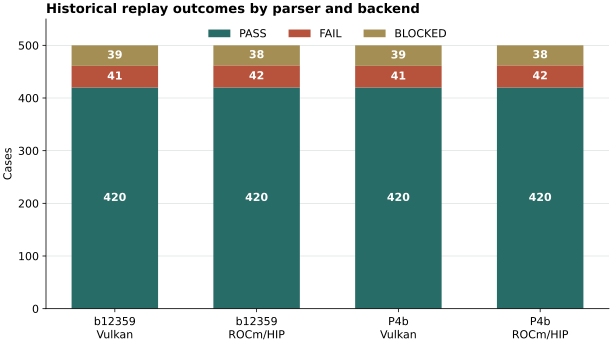

# 小模型 Agentic 能力评估白皮书 · IJ-0.7 阶段版

## 实验结论

在 Windows 11、AMD Ryzen AI MAX+ PRO 395、Radeon 8060S 上，以 MiniCPM5-2B
Q8_0 运行原始 b12359 和 P4b 的 Vulkan、ROCm/HIP 四臂对照。2,000 条任务及 4,422
次模型请求均有可关联记录。每臂 100 个单工具任务和 80 个工具结果回传任务通过 V2
语义检查。100 个多工具任务每臂 84 个语义通过、77 个完整诊断通过。全量完整判定
每臂 420/500。首次回放分数适用于冻结历史负载。 [历史回放](IJ07_HISTORICAL_REPRODUCTION.md)

P4b 修复固定原生夹具中的真实解析缺陷。在相同历史权重、任务与后端上，P4b 没有
改变已观测任务判定。每臂在 15 个历史空标签案例中直接生成空数组。模式在解析前
已出现，API 按该值传递。独立对照还复现最终回答关联错订单的问题。 [失败因果分析](IJ07_MULTITOOL_FAILURE_ROOT_CAUSE.md)

## 运行时与模型边界

固定输入、模型自主生成、真实业务状态三者需要独立考察。P4b 对固定句法的改进无法
预测历史任务正确率。改用 b12675 的 Radeon 上游试验产生 106/146 固定夹具通过及
0/16 历史失败任务通过。错误格式的显式 `tool_choice` 可被旧 API 当成自动选择，
本地补丁提交前后在 CPU JSON 与 SSE 上验证了最小修复。Radeon 候选复验也拒绝
非法选择。 [源码根因与测试](IJ07_SOURCE_LEVEL_ROOT_CAUSE_MASTER_REPORT.md)

当前 SDK 的 AG-06 在两个真实 GPU 后端各 1/3 成功。失败时结构化值包含 SDK
送回模型的序列化 `result` 对象。原始 SSE 显示出错值已出现在 `finish.status`，
其沿回调保持原值。AG-11 进程出站证明仍未完成。 [AG-06 重复记录](../evidence/IJ07/antigravity/)

## 候选能力与未知项

修正配置下 LFM3、Qwen3.5、Ministral 和 Gemma 通过统一 Vulkan 准入探针，
Granite 和 Qwen3-8B 分别提供规模扩展及大模型参考。MiniCPM5 在这个关闭思考的
配置中未通过首轮工具调用。Aion CPU 和 Radeon WebGPU 真机完成普通对话，工具
规划能力与统一运行时排名未测。当前数据可选择后续实验臂，无法实证模型的长链、
中文岗位、恢复、可靠性和边缘部署综合排序。 [能力矩阵](IJ07_MODEL_ADMISSION_MATRIX.md)

两条规划任务、每条两种轨道共四次诊断均失败。可见偏差含计划结构、提前使用未获
业务引用以及最终事实不符。另四条 2–3 步多工具诊断均失败。四例无法估计长链衰减。
正式数据冻结包括 TC-V2 500 条、MULTITOOL-V1 600 条、AGENTIC-PLAN-V1 800 条，
以及各自的重复面板。能力档案给出当前证据边界。 [规划](IJ07_AUTONOMOUS_PLANNING_BENCHMARK.md)
 · [多工具](IJ07_MULTITOOL_CAPABILITY_REPORT.md) · [档案](../evidence/IJ07/model_passports/)

## 业务决策与端侧部署

在实际业务提交前保留独立规则、授权与确认。透明结构化输入可直接走 SOP；允许小模型
提议不确定字段或已验证的只读工具流程。无效或高风险提议应记录并停止。现有三个
结构化岗位开发样本只提供有限的系统贡献证据。JOB-V1 无模型 F 臂在 600 条任务中
首试通过 592 条，实际业务完成 342 条。A–E 和配对贡献尚未完成，99% 和调用轮次
十分之一仍是待验证目标。 [岗位结果](IJ07_PURPOSE_BUILT_VALIDATION.md) · [架构建议](IJ07_JOBBOT_ARCHITECTURE_RECOMMENDATION.md)

历史负载的 ROCm/HIP prefill 较高且 Vulkan decode 较高，GFX1151 上具备足以支撑
下一段诊断的本地推理资源。独立性能报告给出具体预算、采集窗口和峰值。DX-M2
另有可测试的模型、KV 缓存及算子需求。迁移硬件与能耗资格保持 `NOT_RUN`。
 [GPU 证据](IJ07_GPU_PERFORMANCE.md) · [DX-M2 迁移要求](../portability/deepx-dxm2/IJ07_DEPLOYMENT_REQUIREMENTS.md)
