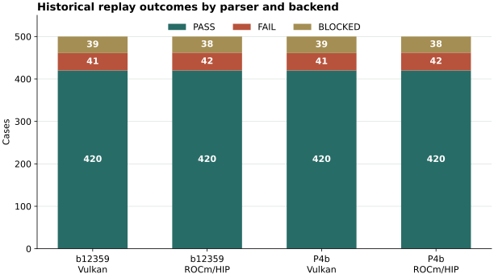

# Small language model agentic capability · IJ-0.7 interim white paper

## Historical controlled experiment

The four-arm experiment ran MiniCPM5-2B Q8_0 on native Windows 11 and a Radeon
8060S. It paired original b12359 with P4b on Vulkan and ROCm/HIP, capturing
2,000 tasks and 4,422 requests. Each arm passed the semantic check for all
100 single-tool and 80 result-round-trip scenarios in the frozen history.
Each passed 84 of 100 dependent multi-tool traces and received 77 complete
diagnostic passes. The full diagnostic count was 420 of 500 per arm.
 [Historical experiment and archive](IJ07_HISTORICAL_REPRODUCTION.md)

P4b preserved the complete per-case outcomes on each backend. In all four
arms, the same 15 cases generated empty tags before parsing. The protocol
preserved those arrays. Another repeated case retrieved the correct facts
and attributed them to the wrong order in the final answer. The original
historical raw generations were unavailable. The observations locate the
new failures and leave prompt, schema, sampling, precision and training
contributions open. [Per-case causal evidence](IJ07_MULTITOOL_FAILURE_ROOT_CAUSE.md)

## Runtime and competitive evidence

P4b's fixed-output parser improvements are separately demonstrated. The
newer b12675 Vulkan arm passed 106 of 146 fixtures and none of 16 selected
historical failures. A distinct patch fixed an HTTP input-validation defect
that treated a malformed explicit tool selector as auto. A single-variable
CPU experiment verified JSON and SSE rejection before and after the fix.
The seven Radeon probes verified the patched rejection under their actual
model configurations. [Sources, patch and control](IJ07_SOURCE_LEVEL_ROOT_CAUSE_MASTER_REPORT.md)

LFM3, Qwen3.5, Ministral and Gemma passed the revised shared Vulkan admission
probe. Granite and Qwen3-8B passed as additional size references.
MiniCPM5's revised non-thinking profile failed its initial native tool call
while passing the schema and negative-path checks. Aion generated the
expected ordinary text on CPU and on Radeon with the official ONNX WebGPU
build. Appoint model and runtime together for each experiment. The data
has insufficient matched independent tasks to rank any model's complex
planning, Chinese workflow performance or deployment efficiency.
 [Candidate matrix](IJ07_MODEL_ADMISSION_MATRIX.md)

AG-06 succeeded in one of three repetitions on each backend. Failing SDK
outputs carried the model's nested serialized tool result in the finish
callback. AG-11 remains blocked on complete process egress observation or
isolation. [SDK evidence](../evidence/IJ07/antigravity/)

## Autonomy, business value and deployment

The first two planning cases failed on both the Plan-first and Acting-first
tracks. The first four selected multi-tool diagnostics also failed. Their
evidence shows missing calls, premature entity references, incorrect
recovery choices, and final-output mismatch. The full frozen independent
cases and repeat panels are needed for confidence intervals, defensible
capability levels, depth curves, and model-to-model differences.
 [Planning](IJ07_AUTONOMOUS_PLANNING_BENCHMARK.md) · [Multi-tool](IJ07_MULTITOOL_CAPABILITY_REPORT.md)

Preserve deterministic validation, explicit proposal provenance, and trusted
confirmation as the common decision boundary. The structured IJ-0.6 job
rehearsal provides observations on three tasks. The independent job
baseline scored 592/600 first-pass outcomes under deterministic Arm F,
with 342 actual business completions. Arms A–E and paired causal estimates
remain pending. The 99% target and tenfold interaction reduction still
require corroboration. [JOB-V1 stage evidence](IJ07_PURPOSE_BUILT_VALIDATION.md)
 · [Architecture analysis](IJ07_JOBBOT_ARCHITECTURE_RECOMMENDATION.md)

The measured Radeon workload favors ROCm/HIP prefill and Vulkan decode
under the tested model, context and budget. It provides sizing data for
future backend and precision studies. Hardware energy, long soak and DX-M2
execution remain open. [GPU measurements](IJ07_GPU_PERFORMANCE.md)
 · [DX-M2 requirements](../portability/deepx-dxm2/IJ07_DEPLOYMENT_REQUIREMENTS.md)
