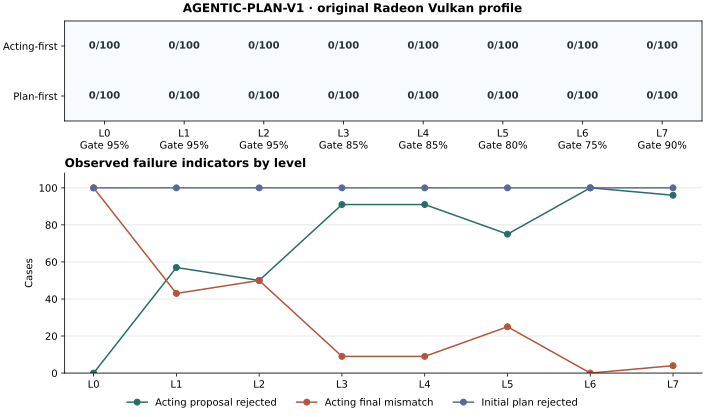

# IJ-0.7 自主规划验证记录

AGENTIC-PLAN-V1 冻结 800 个任务，L0–L7 各 100 个。每个等级有 50 个英文及 50 个中文案例。独立图 oracle 验证参考依赖、等价顺序、信任确认、最终事实和持久业务状态。Plan-first 与 Acting-first 使用同一任务，但按各自协议判断。160 个预选重复案例固定三个种子。 [任务及运行说明](../benchmarks/agentic_planning_v1/README.md)

已验证档案将 4 条诊断轨迹、5 次源码观察和正式队列的 1,600 个计划试次分开。
下文分别报告诊断、首个闭合会话和全量首轮。 [诊断档案完整性及分级数据](../evidence/IJ07/planning/diagnostic_verified_summary.json)

## 双轨首个全量等级

MiniCPM5-2B 完成 L0 的 200 个真实 Vulkan 试次。两种轨道均为 0/100，
对各自 95% 门槛为 `FAIL`。同 PID GPU 采样和 200/200 个请求的源码输出均
可核验。此档案保留首个闭合会话。
 [L0 检查点、原始日志和清单](../evidence/IJ07/planning/primary-l0-checkpoint/)

Acting-first 的 100 个输出中 90 个选择澄清，10 个返回任务理解，独立判定均失败。
Plan-first 的 100 个首轮均未达到计划合同，其中 96 个对象使用错误字段，
4 个计划缺失或无法解析。样例 `AP1-L0-001` 的 Acting-first 输出把已给定的
只读发票目标当作信息不足。Plan-first 输出直接使用终态澄清字段。两种实际
输出都存在于相关请求的源观察，提示合同的独立影响仍待控制。
 [双轨研究数据](../evidence/IJ07/planning/primary-l0-checkpoint/diagnostic.json)

L1/L2 另定位到一个中文输入的运行时缺陷。原正则使用 Unicode 单词边界，
导致相邻的汉字遮蔽了请求中的 ASCII 引用。在 100 条进入此边界的原始首轮
响应上，修复前均拒绝，修复后均通过提议校验。带 ASCII 后缀的标识片段仍被
拒绝。全量原运行和修订后的任务结果继续使用各自身份。
 [100 条原样提议对照](../evidence/IJ07/root_causes/planning_reference_boundary_control.json)

## 完整 L0–L7 双轨结果

八个 Radeon Vulkan 会话总计 1,600 条终态，2,719/2,719 次模型请求匹配
解析前源码观察。每个等级的两种轨道均完成 100 条。原配置下，两条轨道各
0/800，分别为 800 次失败，没有中断或待判。单轨单等级零通过的 Wilson 95%
上限约 3.70%。两轨均无法获得连续等级。
 [全量分级统计和 7 卷原始档案](../evidence/IJ07/planning/primary-vulkan-full/)

| 等级 | 判定门槛 | Acting-first | Plan-first | Acting-first 模型动作 |
|---|---:|---:|---:|---:|
| L0 | 95% | 0/100 | 0/100 | 0 |
| L1 | 95% | 0/100 | 0/100 | 96 |
| L2 | 95% | 0/100 | 0/100 | 136 |
| L3 | 85% | 0/100 | 0/100 | 265 |
| L4 | 85% | 0/100 | 0/100 | 396 |
| L5 | 80% | 0/100 | 0/100 | 206 |
| L6 | 75% | 0/100 | 0/100 | 202 |
| L7 | 90% | 0/100 | 0/100 | 121 |

Plan-first 的 800 个首轮计划均未达到执行合同，因而未执行工具。Acting-first
记录 1,422 个模型动作。560 条有提议被拒的标记，240 条有最终答案
不符的标记，失败标记可重叠。按各自预设适用任务，两轨动态重新规划均为
0/250，环境变化后恢复均为 0/228。两轨的英文、中文各完成 400 条，均无完整
通过。两轨均无未授权变更、无未确认提交或重复变更。
 [完整计数、指标分母及四状态](../evidence/IJ07/planning/primary-vulkan-full/diagnostic.json)

原运行包含已确认的中文引用缺陷。四条独立 CPU 开发任务的两种首轮合同
控制均为 0/4。请求、首轮计划和状态可归因到具体边界，修正后模型能否
完成整套规划仍需独立运行。冻结的重复面板为 `NOT_RUN`。
 [CPU 控制](../evidence/IJ07/root_causes/planning_prompt_stage_cpu.json)

修订引用校验的两个真机诊断都执行了工具。L1 样本执行三步后超过动作预算，
L2 样本取回正确事实，但最终状态使用合同外的 `verified`。两案仍为 `FAIL`。
 [修订配置两条轨迹](../evidence/IJ07/planning/reference-fix-diagnostic/)

| 小样诊断 | Acting-first | Plan-first | 首个可观测偏差 |
|---|---|---|---|
| AP1-L2-001 | FAIL | FAIL | Acting-first 的最终事实不满足；Plan-first 首回合未提供要求的计划字段。 |
| AP1-L7-001 | FAIL | FAIL | Acting-first 使用尚未获得的业务引用；Plan-first 首回合未提供要求的计划字段。 |

四条记录均来自真实 Radeon Vulkan。未授权变更、未经确认提交及重复提交的观测均为零。这两案是单列的早期诊断。 [逐条诊断](../evidence/IJ07/planning/diagnostic/)
