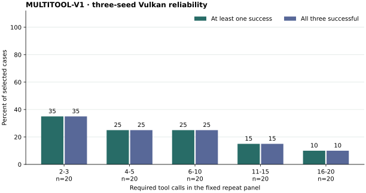

# IJ-0.7 MULTITOOL-V1 验证记录

独立数据冻结 600 条任务，8 个类别各 75 条，覆盖五个深度档和中英混合三种语言模式。另有六条零调用诊断和 100 条三种子重复面板。模拟异常按试例及有效调用顺序确定。SQLite 记录合规草稿与安全终止，验证 SQL 前后状态及真实业务作用的判定。此冻结的数据与软件参考走查无需执行模型。 [测试规范](../benchmarks/multitool_v1/README.md)

| 真实 Vulkan 诊断 | 判定 | 首个或关键偏差 |
|---|---|---|
| MT-01-001 | FAIL | 重复调用普通库存工具，漏掉冷库库存工具。 |
| MT-06-001 | FAIL | 超时后选择镜像和 checkpoint，未完成期望的恢复路径。 |
| MT-07-001 | FAIL | 模型先请求澄清，未获取触发新用户消息所需的初始事件。 |
| MT-08-002 | FAIL | 有草稿回执，额外调用无结果，最终输出格式与 oracle 不一致。 |

四条选定任务的流水线保留了来源、模型调用和工具响应。本组 0/4 通过。四例均在 2–3 步档。 [逐条诊断](../evidence/IJ07/multitool/diagnostic/)

## 600 条真实 Vulkan 首轮

全部 600 条具有独立的终态，129 条通过、471 条失败，首试正确率 21.5%。
整体无中断，同 PID GPU 执行和每请求源码采集已核验。英、中、混合语言分别通过
62/200、43/200、24/200。数据在 8 个类别及 5 个深度档内均衡。
 [全量原始检查点和 GPU 证据](../evidence/IJ07/multitool/primary-vulkan-full/)

| 类别 | 通过 / 总数 |
|---|---:|
| MT-01 独立冷库与常温库存 | 18/75 |
| MT-02 依赖的路线、派单和检查点 | 53/75 |
| MT-03 库存与历史对照 | 20/75 |
| MT-04 条件分支 | 1/75 |
| MT-05 嵌套与组合参数 | 27/75 |
| MT-06 异常恢复 | 2/75 |
| MT-07 用户新约束 | 4/75 |
| MT-08 权限、草稿及安全终止 | 4/75 |

| 指标 | 观察值 |
|---|---:|
| 首个工具选择正确 | 437/600 |
| Runner 原生解析适用状态 | 492 PASS，108 NOT_RUN |
| 工具节点选择 precision / recall / F1 | 72.79% / 57.37% / 64.17% |
| 全步骤所需参数字段正确 | 2,678/5,632 |
| 整个工具参数对象匹配 | 2,592/5,520 个预期节点 |
| 在依赖结果后提出对应工具 | 1,069/2,612 个依赖节点 |
| 参数、依赖及返回值均核验通过 | 818/2,612 个依赖节点 |
| 实际并行调用且任务通过 | 18/63 个发生批量调用的 MT-01 案例 |
| 正确最终答案 | 155/600 |
| 持久业务状态正确 | 53/75 个有状态案例 |
| 拒绝或安全终止的完整任务通过 | 0/38 |
| 未授权或未确认的持久化副作用 | 0 |
| Wire 可见无效提议 | 0/4,878 |
| 额外或重复调用 | 1,147/4,351 个已进入评估的调用 |
| 在预算内给出最终响应 | 515/600 |
| 三种子 Pass@3 和 Pass^3 | 均为 22/100 |

工具选择按照独立图分配的节点计算，参数与依赖单独评分。最终响应受纯 JSON
约定约束。38 条预期安全终止未达到完整任务判定，SQLite 审计没有发现未授权写入。
 [机器可读指标](../evidence/IJ07/multitool/primary-vulkan-full/metrics.json)
 · [复杂度报告](IJ07_MULTITOOL_COMPLEXITY_DECAY.md)

## 100 案例的三种子重复

原始 Vulkan 配置完成 300/300 条，66 次通过、234 次失败。种子 48707、65719 和
98123 的通过率均为 22%。22 个案例三次均通过，78 个案例三次均失败，逐案
通过状态无变化。Pass@3 与 Pass^3 均为 22/100，Wilson 95% 区间为
15.00–31.07%。温度保持 0。 [三种子记录和失败类型转移](../evidence/IJ07/multitool/repeat-vulkan-full/reliability.json)

## 同一生成的 Wire 对照

在 `MT-01-062`，原始生成与 HTTP 响应各包含 17 个工具调用，原网关固定上限为
16，导致本轮在任何工具执行前停止。保留记录中 14 个同类响应均在默认上限被拒绝，
在 MULTITOOL 明确使用 32 提议预算的新解码路径均通过 wire 检查。原记录结果仍保留。
14 个批次的工具名和全部参数也与各自独立图的完整并行计划一致。下一轮需要测量
网关放行后模型能否用实际回传完成独立业务目标。
 [同一字节的解码对照](../evidence/IJ07/root_causes/multitool_batch_limit_control.json)
 · [213 案例源检查点](../evidence/IJ07/multitool/primary-vulkan-checkpoint/)

在全量归档中，原 wire 上限拦截 25 批，32 调用配置对同一批次全部放行。
其中 19 批对应无依赖的独立图，工具名与完整参数均匹配。其余六批涉及依赖关系，
该静态集合对照不适用。 [全量 wire 对照](../evidence/IJ07/root_causes/multitool_batch_limit_full_control.json)

新配置的两个真机复验分别执行 17 和 18 个合成工具调用。MT-01-062 的最终 JSON
与约定形状不同，MT-03-061 的后续提议超过任务预算。两条业务结果均为 `FAIL`。
 [独立真机修订配置](../evidence/IJ07/multitool/wire-fix-diagnostic/)
