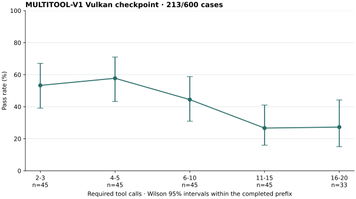

# IJ-0.7 MULTITOOL-V1 验证记录

独立数据冻结 600 条任务，8 个类别各 75 条，覆盖五个深度档和中英混合三种语言模式。另有六条零调用诊断和 100 条三种子重复面板。模拟异常按试例及有效调用顺序确定。SQLite 记录合规草稿与安全终止，验证 SQL 前后状态及真实业务作用的判定。此冻结的数据与软件参考走查无需执行模型。 [测试规范](../benchmarks/multitool_v1/README.md)

| 真实 Vulkan 诊断 | 判定 | 首个或关键偏差 |
|---|---|---|
| MT-01-001 | FAIL | 重复调用普通库存工具，漏掉冷库库存工具。 |
| MT-06-001 | FAIL | 超时后选择镜像和 checkpoint，未完成期望的恢复路径。 |
| MT-07-001 | FAIL | 模型先请求澄清，未获取触发新用户消息所需的初始事件。 |
| MT-08-002 | FAIL | 有草稿回执，额外调用无结果，最终输出格式与 oracle 不一致。 |

四条选定任务的流水线保留了来源、模型调用和工具响应。本组 0/4 通过。四例均在 2–3 步档。 [逐条诊断](../evidence/IJ07/multitool/diagnostic/)

## 600 条首轮的阶段证据

固定批次检查点保存 213 条终态，91 条通过、122 条失败，另有 387 条在此时尚未执行。
MT-01 通过 18/75，MT-02 通过 53/75，MT-03 的已完成部分通过 20/63，覆盖五个深度档。
该顺序前缀的类别组成随进度变化，全量曲线、总体比率与可靠性面板仍待完成。
 [原始检查点和 GPU 证据](../evidence/IJ07/multitool/primary-vulkan-checkpoint/)

在 `MT-01-062`，原始生成与 HTTP 响应各包含 17 个工具调用，原网关固定上限为
16，导致本轮在任何工具执行前停止。保留记录中 14 个同类响应均在默认上限被拒绝，
在 MULTITOOL 明确使用 32 提议预算的新解码路径均通过 wire 检查。原记录结果仍保留。
14 个批次的工具名和全部参数也与各自独立图的完整并行计划一致。下一轮需要测量
网关放行后模型能否用实际回传完成独立业务目标。
 [同一字节的解码对照](../evidence/IJ07/root_causes/multitool_batch_limit_control.json)
