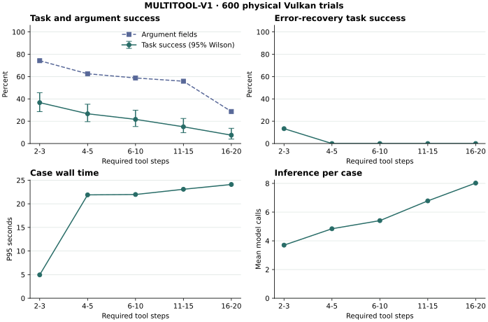
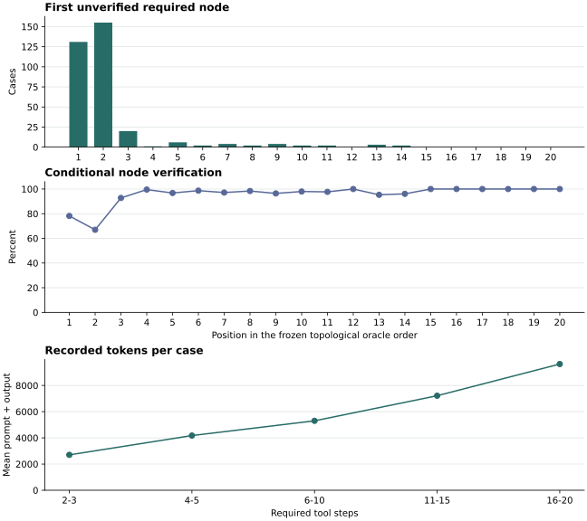

# IJ-0.7 多工具任务随深度的变化

600 条真实 Windows Radeon Vulkan 首试使用原 16 调用 wire 限制。每档
120 条任务，类别与语言均衡；MT-06 每档含 15 条预设故障验证。
 [任务冻结与运行身份](IJ07_MULTITOOL_CAPABILITY_REPORT.md)

| 要求步骤数 | 任务通过 | Wilson 95% | 参数字段正确 | 恢复类通过 | 平均模型调用 | 每案 P95 秒 | 平均记录 token |
|---|---:|---:|---:|---:|---:|---:|---:|
| 2–3 | 44/120 | 28.58–45.58% | 74.22% | 2/15 | 3.70 | 4.95 | 2,702 |
| 4–5 | 32/120 | 19.57–35.21% | 62.52% | 0/15 | 4.84 | 21.89 | 4,175 |
| 6–10 | 26/120 | 15.24–29.85% | 58.76% | 0/15 | 5.41 | 21.97 | 5,301 |
| 11–15 | 18/120 | 9.70–22.47% | 55.84% | 0/15 | 6.78 | 23.08 | 7,218 |
| 16–20 | 9/120 | 4.00–13.64% | 28.69% | 0/15 | 8.03 | 24.09 | 9,635 |

按冻结图固定拓扑顺序，首个无法核验的必要节点出现在第一步 131 次、第二步 155 次。
第一步核验通过为 469/600。第一步已验证并需要后续步骤的 469 条中，
第二步通过 314 条。第 20 步的 5/5 仅覆盖通过此前步骤且需要第 20 步的 5 条。
这些条件分母随节点筛选缩小。独立工具可合法换序，节点位置取冻结图的排序，
延迟覆盖实际模型调用、回传和本地测试服务。任务模板在同一类别内重复，区间用于
描述当前面板。 [指标和分母](../evidence/IJ07/multitool/primary-vulkan-full/metrics.json)

