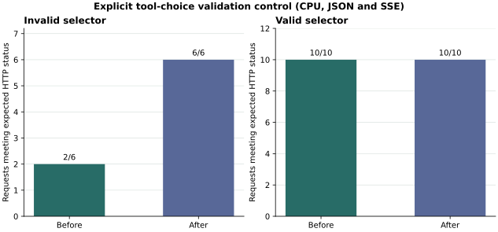

# IJ-0.7 源码根因阶段记录

## RC-11 误接受显式对象型 tool_choice

共同 b12359 构建对未知工具的对象型选择返回 HTTP 200，并继续自动选择工具。根因是 `oaicompat_chat_params_parse` 用 `json_value(..., std::string("auto"))` 读取该字段。该模板遇到类型错误会记录警告并返回默认值。原生选择解析函数只实现 `auto`、`none`、`required` 三个字符串模式。 [精确服务器源码](https://github.com/ggml-org/llama.cpp/blob/b1b770d90d94cad9e9ea5b993bdbc383a522fb28/tools/server/server-common.cpp#L1425) · [读取函数](https://github.com/ggml-org/llama.cpp/blob/b1b770d90d94cad9e9ea5b993bdbc383a522fb28/tools/server/server-common.h#L45) · [准入原始记录](../evidence/IJ07/model_identity/admission/)

本地最小变更在选择解析前拒绝显式的非空非字符串类型，HTTP 包装器将 `std::invalid_argument` 映射为 HTTP 400。保留省略、null 和三种受支持字符串的现有行为。当前补丁对对象型强制命名选择显式报错。该功能可独立评审。 [补丁](../patches/ij07/llama-b12359-explicit-tool-choice.patch) · [对照工具](../benchmarks/root_cause/probe_tool_choice.py)

CPU 单变量 RED/GREEN 覆盖 8 个请求形状 × JSON/SSE。非法数字和对象从 HTTP 200 变为 400，无效字符串仍为 400，五组合法相邻条件的语义一致。补丁另用于第二轮物理 Radeon 候选试验，七个 GGUF 均显式返回 400。RC-11 根因为 `CONFIRMED_CAUSAL`，此次二进制保持独立身份。 [CPU 配对数据](../evidence/IJ07/root_causes/explicit_tool_choice_cpu.json) · [GPU 候选数据](../evidence/IJ07/model_identity/admission_strict/)

上游评审草稿包括最小请求、兼容行为与确切回归。 [评审草稿](../patches/ij07/EXPLICIT_TOOL_CHOICE_UPSTREAM_DRAFT.md)

## RC-18 多工具预算和 wire 上限不一致

MULTITOOL-V1 硬预算允许每任务 32 次提议，非流式解码默认最多接受 16 个同批调用。
首轮检查点内 14 次响应在解析前与 wire 已形成完整工具调用，原解码仍以
`invalid tool call batch` 拒绝。只改变解码上限的字节级对照使 14/14 可被解码。
默认与流式限制保持 16。MULTITOOL 运行器显式选用 32，并仍在操作前校验全任务
提议预算、结构、调用身份和工具权限。原始业务判定和后续真实得分独立记录。
 [原样复验](../evidence/IJ07/root_causes/multitool_batch_limit_control.json)

600 条归档覆盖 25 个同类 wire 拒绝。修订配置解码通过 25/25，
其中 19 个批次与无依赖任务的完整独立图一致。
 [全量对照](../evidence/IJ07/root_causes/multitool_batch_limit_full_control.json)

## 双轨规划中的中文引用边界

Acting-first 的 L1/L2 首轮样本存在源生成与 HTTP 一致的合法 `reference`。
Planning Boundary 使用 Unicode 单词边界提取公开输入的引用，紧邻汉字的 ASCII
编号从许可集合中消失。修订以明确的 ASCII 编号字母表判定边界，并拒绝更长标识
的片段。逐一使用 100 条原请求的同一提议验证，原校验拒绝 100 条，修订通过
100 条。该复验没有执行工具。L0 的模型与合同失败不受此改动影响。
 [原始参数、token、拒绝原因和复验](../evidence/IJ07/root_causes/planning_reference_boundary_control.json)

在四条独立于冻结集的双语开发输入上，另以同一 CPU 构建比较首轮同时给出计划及
最终回答说明，与移除首轮最终回答说明。两个配置的可执行且正确理解目标的计划均为
0/4。模型的字段错误形式发生变化，单独移除该说明不足以恢复计划合同。
 [CPU 开发输入对照](../evidence/IJ07/root_causes/planning_prompt_stage_cpu.json)

471 条 MULTITOOL 和 1,600 条规划首轮失败均索引到原始分卷及检查点摘要。
规划记录还保留逐回合日志定位。索引标注已观察到的拒绝或判定边界，单变量
对照覆盖的记录另有链接。超出已复验范围的成因仍待单案验证。
 [2,071 条真机失败索引](../evidence/IJ07/root_causes/physical_primary_failure_index.jsonl)

## RC-04 / RC-13 空 tags 生成与目标不一致

模型在四臂的 `tc-seq-0001` 直接生成空数组。原始工具 Schema 允许空数组，目标明确要求两条标签。空数组在所见原生解析、JSON 和历史模拟处理过程保持为空。当前证据确定错误出现于解析前，原始历史调用及空数组成因分别保留 `ROOT_CAUSE_UNVERIFIED`。 [逐案分析](IJ07_MULTITOOL_FAILURE_ROOT_CAUSE.md)

CPU 对照保留原权重、任务和采样，只为该诊断-臂在数组 Schema 指定 `minItems: 2`。该字段经 `common/json-schema.cpp` 成为数组约束，再进入 `common/json-schema-to-grammar.cpp` 的 `build_repetition`。15/15 由语义失败变为语义通过。原 Schema 的 F16 仍有 14/15 空数组。Schema 是该诊断配置的可控因素。原始归档的不可观测生成及模型训练机制仍需独立证据。 [对照证据](../evidence/IJ07/root_causes/ticket_tags_counterfactual/summary.json)

## JOB-V1 确定性收据更正边界

`arm_f.corrected_field` 先识别更正意图，再以 `ORDER_TARGET` 提取唯一目标。
原表达式遗漏 `receipt corrected to`，触发 `followup_ambiguous`，因而在权限和
读工具之前停止。新增该明确表达式后，新目标仍要满足相同 Gateway 授权。
独立构造的正例和无订单更正、目标冲突的反例通过回归。逐案单变量运行对比使用
一致的源文件摘要，仅 `arm_f.py` 不同。两版完整保留各自的输入、原始业务审计、
评分及 SQLite 摘要。 [源码回归](../tests/regression/ij07/test_job_v1_arm_f.py) · [单变量证据](../evidence/IJ07/job_ablation/F/receipt-correction/comparison.json)

## AG-06 结构化结果

工具结果由 SDK 包为 `{"result": "ORDER-READY-X621"}` 后进入模型消息。失败时，
模型 SSE 的 `finish.status` 已包含序列化的整个对象，SDK 返回相同字符串。
真实 SDK 的 CPU 单变量提示对照从 1/3 变为 3/3。解析前生成和修订提示的
Radeon 资格仍待采。AG-11 需要可信进程级出站证据。
 [SSE 独立复核](../evidence/IJ07/root_causes/ag06_archived_wire.json) · [SDK CPU 控制](../evidence/IJ07/antigravity/ag06_prompt_cpu_control.json) · [验收规范](../docs/ANTIGRAVITY_SDK_ACCEPTANCE_SPEC.md)

## 上游比较

截至核查时，llama.cpp 默认分支为 `2a487782f2f218bc6c01e1f366a7e73f002faf08`。MiniCPM5 parser 从固定版本后已随 #29307 切换到 token-aware 解析、调整 CDATA 和字符串闭合规则。#32746 已关闭且未合并。同期已发布的 `b12675` 上游臂固定夹具 106/146，选定历史失败 0/16 通过。 [核查源码](https://github.com/ggml-org/llama.cpp/blob/2a487782f2f218bc6c01e1f366a7e73f002faf08/common/parsers/minicpm5.cpp) · [#29307](https://github.com/ggml-org/llama.cpp/pull/29307) · [#32746](https://github.com/ggml-org/llama.cpp/pull/32746) · [运行证据](../evidence/IJ07/historical_replay/upstream_b12675/report.json)
