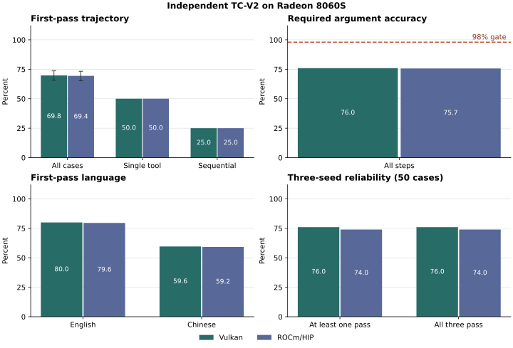

# IJ-0.7 独立 TC-V2

数据冻结于独立图、严格原生参数和 SQLite 状态评分前。500 条首试、500 次
完整流式配对、50 案例 × 3 种子及 146 条固定输出夹具各有独立身份。
 [冻结数据与恢复方法](../benchmarks/tool_calling_v2/holdout/README.md)

| 指标 | Vulkan P4b | ROCm/HIP P4b | ADR-002 门槛 |
|---|---:|---:|---:|
| 首试通过 | 349/500 (69.8%) | 347/500 (69.4%) | ≥90% |
| 首试 Wilson 95% 区间 | 65.64–73.66% | 65.23–73.28% | 记录 |
| 单工具 | 50/100 | 50/100 | ≥95% |
| 结果回传 | 79/80 | 79/80 | ≥95% |
| 连续多工具 | 25/100 | 25/100 | ≥85% |
| 全步骤参数 | 75.96% | 75.70% | ≥98% |
| 无效提议 | 0/494 | 0/492 | ≤1% |
| 流式及思考配对 | 375/500 | 374/500 | 100% |
| 三次至少通过一次 | 38/50 | 37/50 | 记录 |
| 三次均通过 | 38/50 | 37/50 | 记录 |
| 未授权或未确认副作用、虚假执行声明 | 0 次 | 0 次 | 0 次 |
| 自动评分无法判断的表述 | 0 | 2 | 记录 |
| 固定协议夹具（含 119 个适用原生输入） | 146/146 | 146/146 | 100% |

两个后端资格均为 `FAIL`。英文首试在 Vulkan、ROCm/HIP 分别通过 200/250 和
199/250，中文分别通过 149/250 和 148/250。缺失预期调用也会使配对失败。
`TCV2-H-0002` 未提出预期的 `read_bin`，两个后端都在解析前直接生成
`{"on_hand": null}`。语言、指令和模板的独立影响仍待控制。ROCm/HIP 有五次提议被
权限规则拦截。另两条表述分别是同一案例的首试及流式输出，人工读取均报告查询
失败。库存前后快照一致，原评分保持原样。 [失败索引](../evidence/IJ07/tc_v2/holdout/failure_index.jsonl)
 · [表述复核](../evidence/IJ07/tc_v2/holdout/rocm-safety-adjudication.json)

同一 500 条首试中，两后端均通过 347 条、均失败 151 条，其余两条仅 Vulkan
通过。配对双侧精确 McNemar `p = 0.5`。当前样本没有提供后端通过率差异的显著证据。

冻结运行器对固定输出夹具会话也要求普通自由生成使用的源码观察文件。实际固定
输出夹具已保存强制 EOS 和同 PID GPU 证据。原始摘要保留 `coverage_and_provenance:
BLOCKED`。分阶段补充证明对两个后端的任务和固定夹具分别复核 GPU 和采集要求。
 [Vulkan 原始归档](../evidence/IJ07/tc_v2/holdout/vulkan/) · [ROCm/HIP 原始归档](../evidence/IJ07/tc_v2/holdout/rocm/)

